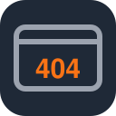

<p align="center">
  
</p>

<h1 align="center">Unraid Templates</h1>

<p align="center">
  <a href="https://github.com/repires/unraid-templates/actions"></a>&nbsp;
  <a href="#templates"></a>&nbsp;
  <a href="https://github.com/repires/unraid-templates/commits/main"></a>&nbsp;
  <a href="https://unraid.net"></a>&nbsp;
  <a href="LICENSE"></a>
</p>

<p align="center">
  Docker XML templates for Unraid, published in Community Applications as <b>pires' Repository</b>.<br>
  Maintained for modern AI workflows, media tools, and self-hosted services.
</p>

---

## Templates

### AI & Agents


<a href="https://github.com/akitaonrails/ai-memory#readme"></a>
<a href="templates/ai-memory.xml"></a>

**ai-memory**<br>
Persistent, shared memory for AI coding agents over MCP: session capture, a searchable wiki, and handoffs between agents. Runs upstream `akitaonrails/ai-memory:latest`.

<br clear="all">


<a href="https://github.com/milind-soni/OpenMausBot#readme"></a>
<a href="templates/openmausbot.xml"></a>

**OpenMausBot**<br>
Open-source workspace for AI bots: chat with bots that run Claude Code, Codex, OpenCode and other engines, each with its own shell, files, and browser. Runs upstream `ghcr.io/milind-soni/openmausbot:latest`.

<br clear="all">


<a href="https://rakazo.com"></a>
<a href="templates/rakazo-web.xml"></a>

**Rakazo**<br>
Open-source Grok Bot alternative with persistent AI teammates, memory, routines, and Docker computers. Packaged as 4 coordinated templates: `rakazo-postgres`, `rakazo-supervisor`, `rakazo-api`, and `rakazo-web`.

<br clear="all">


<a href="https://nod.n8n.io"></a>
<a href="templates/nod-server.xml"></a>

**Nod**<br>
Self-hosted personal AI assistant from the n8n team. Packaged as 6 templates with secure network isolation and custom-built GHCR images: `nod-postgres`, `nod-runtime`, `nod-browser-unraid`, `nod-workspace-network`, `nod-workspace-unraid`, and `nod-server`.

<br clear="all">

---

### Media & Automation


<a href="https://github.com/drolosoft/immich-photo-manager#readme"></a>
<a href="templates/immich-photo-manager.xml"></a>

**immich-photo-manager**<br>
Model Context Protocol (MCP) server bringing rich Immich photo library management, search, album creation, person/face querying, and PDF/archive exporting to AI agents over HTTP.

<br clear="all">


<a href="https://github.com/txemi/immich-autotag#readme"></a>
<a href="templates/immich-autotag.xml"></a>

**immich-autotag**<br>
Automated rule engine for Immich that batch-processes photo and video libraries: applies smart tags and albums, corrects dates, manages permissions, and schedules runs via cron.

<br clear="all">

---

### Network & Utilities


<a href="https://github.com/tarampampam/error-pages#readme"></a>
<a href="templates/error-pages.xml"></a>

**error-pages**<br>
Lightweight, fast, and responsive HTTP error pages with 50+ built-in themes for Traefik, Nginx, HAProxy, and Caddy.

<br clear="all">


<a href="https://github.com/Zarestia-Dev/rclone-manager#readme"></a>
<a href="templates/rclone-manager.xml"></a>

**RClone Manager**<br>
Modern web-based GUI for managing rclone remotes, transfers, file browsing, and automated synchronization tasks.

<br clear="all">

---

## Install

### Via Community Applications (Recommended)
1. Open the **Apps** tab on your Unraid server.
2. Search for any template name (e.g., `ai-memory`, `openmausbot`, `nod`, `immich-photo-manager`).
3. Click **Install**.

### Manual Template Install
To add a template directly without CA, paste its raw XML URL into **Docker → Add Container → Template**:
```text
https://raw.githubusercontent.com/repires/unraid-templates/main/templates/ai-memory.xml
```

---

## App Setup & Highlights

<details>
<summary><b>ai-memory Setup Details</b></summary>

1. Set **Auth token** (e.g. `openssl rand -hex 32`).
2. Add your server hostnames and IPs to **Allowed hosts** (e.g. `localhost,127.0.0.1,192.168.1.10,tower.local`).
3. Connect MCP clients at `http://<server>:49374/mcp` with header `Authorization: Bearer <token>`.
4. Web console (`/web`) requires HTTPS behind a reverse proxy with **Secure cookie** enabled.
</details>

<details>
<summary><b>OpenMausBot Setup Details</b></summary>

1. Set **Public URL** to your access address (LAN IP or reverse proxy).
2. Run `docker exec openmausbot openmausbot pair` in the Unraid terminal to link your browser or app.
3. Install and configure engines under **Settings → Engines**.
</details>

<details>
<summary><b>Rakazo Stack Setup Details</b></summary>

Requires the `rakazo` Docker network (`docker network create rakazo`). Install the four templates in order:
1. `rakazo-postgres`
2. `rakazo-supervisor`
3. `rakazo-api`
4. `rakazo-web`
Access the interface on port `3000`.
</details>

<details>
<summary><b>Nod Stack Setup Details</b></summary>

Packaged across 6 containers with custom images (`ghcr.io/repires/nod-*`):
1. `nod-postgres` (Database)
2. `nod-runtime` (Docker gateway)
3. `nod-browser-unraid` (Headless browser)
4. `nod-workspace-network` (Workspace firewall)
5. `nod-workspace-unraid` (Execution sandbox)
6. `nod-server` (Application web interface)
</details>

---

## Maintenance & Builds

- **Upstream Images**: Templates for `ai-memory`, `openmausbot`, `error-pages`, `rclone-manager`, `rakazo`, `immich-photo-manager`, and `immich-autotag` track upstream release tags so Unraid's Docker update advisor notifies you of new releases immediately.
- **Nod Automated Builds**: [`nod-images.yml`](.github/workflows/nod-images.yml) monitors upstream releases daily and rebuilds images weekly so Debian/Node security patches remain fresh.
- **Upstream Watcher**: [`upstream-watch.yml`](.github/workflows/upstream-watch.yml) tracks changes in upstream Dockerfiles and dependencies via [`.github/upstream-watch.json`](.github/upstream-watch.json), automatically flagging any breaking upstream adjustments.

---

## Support & Issues

- For template, configuration, or packaging issues, please open an issue in this repository: [repires/unraid-templates/issues](https://github.com/repires/unraid-templates/issues).
- For upstream bugs in the applications themselves, please consult their respective upstream issue trackers.

---

## License

This repository and its templates are licensed under the [MIT License](LICENSE). Third-party applications retain their respective upstream licenses.
